# cli-motion

Terminal animations from a YAML scene: typed commands, highlighted output, spinners, real captured commands, banners and scene transitions, rendered as a crisp animated SVG (or a still) with one of 25 colour themes. Output is deterministic, so regenerating gives byte-identical files and clean git diffs.

It generalises the demo pipeline of [gh-delta](https://github.com/diegomarino/gh-delta): generate the asciicast instead of recording it, render with svg-term, then replace svg-term's moving frame reel with stationary frames so Chromium does not blur the text.

## Install

```bash
npx skills add diegomarino/my-skills@cli-motion
```

Needs Node 20+ and network on first run. ffmpeg is optional (MP4, later release).

## Use

```bash
node cli-motion/scripts/cli-motion.mjs render cli-motion/examples/quick-demo.scene.yaml
node cli-motion/scripts/cli-motion.mjs still  cli-motion/examples/quick-demo.scene.yaml --at end
node cli-motion/scripts/cli-motion.mjs export cli-motion/examples/quick-demo.scene.yaml   # GIF + MP4
node cli-motion/scripts/cli-motion.mjs themes
node cli-motion/scripts/cli-motion.mjs doctor
```



First run installs the pinned dependencies (`yaml`, `figlet`, `@resvg/resvg-js`, `gifenc`, fonts …) into `${XDG_CACHE_HOME:-~/.cache}/cli-motion/<lock-hash>/` with `npm ci`; nothing is written inside the skill folder and nothing is global. svg-term is fetched by `npx svg-term-cli@2.1.1`.

## Layout

```
SKILL.md  README.md
scripts/cli-motion.mjs        CLI: render, still, export, themes, fonts, preview, doctor
scripts/lib/{config,scene,svg,raster}/   options+themes, scene→cast, cast→SVG, SVG→GIF/MP4
scripts/package.json + lock   pinned runtime dependencies
scripts/sync-themes.mjs       regenerate assets/themes from a tui-design checkout
assets/defaults.yaml          every option and its default
assets/{themes,prompts}/  assets/spinners.json
references/*.md               one file per option family
examples/                     scenes and their rendered SVGs
tests/                        node --test
```

## Develop

```bash
node --test cli-motion/tests/*.test.mjs
node cli-motion/scripts/sync-themes.mjs --check     # themes match ../tui-design
```

Themes come from [tui-design](../tui-design/) (MIT/Apache-2.0 palettes, each theme file keeps its license and sources). Options implemented in later releases (dark/light pairs) are already accepted in `assets/defaults.yaml` and marked there.
