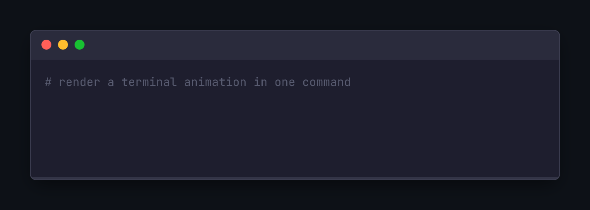
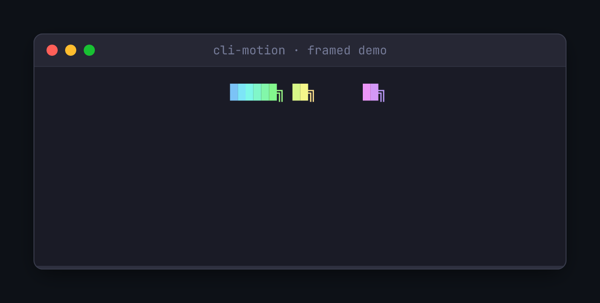
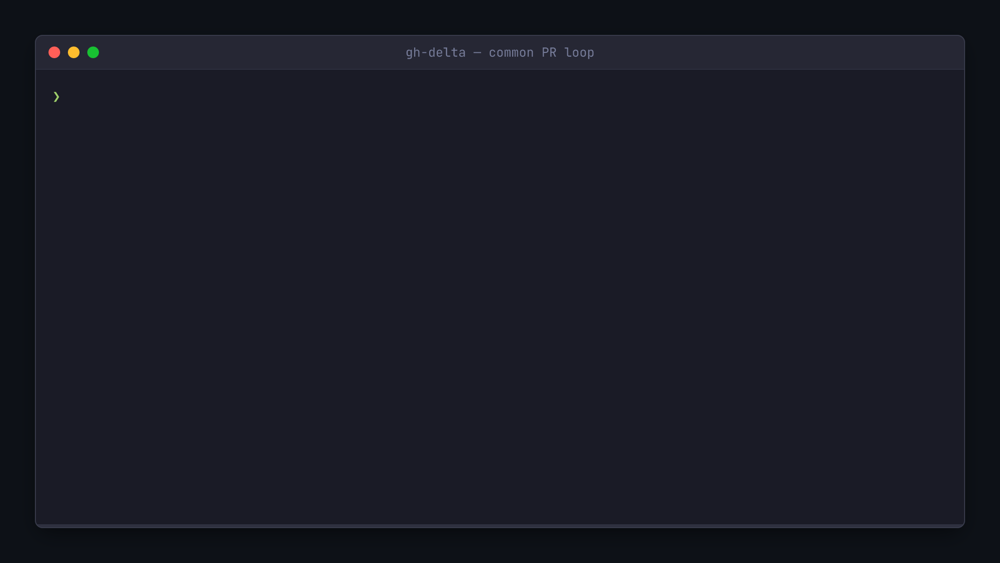
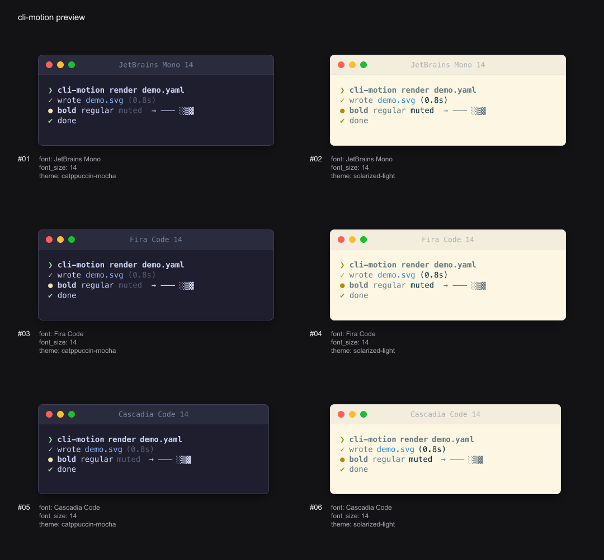

# Examples

Each example is a scene file and its rendered output. These are maintenance commands for a my-skills checkout (an installed skill is never written to, so `-o`/`--out` is required for scenes inside the skill folder). Run them from the skill folder:

| To regenerate | Command |
|---|---|
| a scene's SVG and cast | `node scripts/cli-motion.mjs render examples/quick-demo.scene.yaml --cast -o ./out/quick-demo.svg` |
| its GIF and MP4 | `node scripts/cli-motion.mjs export examples/quick-demo.scene.yaml --out ./out` |
| the preview sheet | `node scripts/cli-motion.mjs preview --out ./out/preview-sheet.png` |

With the same scene and renderer the cast and SVG regenerate byte for byte. GIF and MP4 bytes can differ between encoder versions and machines.

## quick-demo: a command is typed, a spinner runs, the result is highlighted

[`quick-demo.scene.yaml`](quick-demo.scene.yaml) · [SVG](quick-demo.svg) · [GIF](quick-demo.gif) · [MP4](quick-demo.mp4)

GIF version:

## framed-demo: a gradient title banner, then a powerline prompt in a chrome window

[`framed-demo.scene.yaml`](framed-demo.scene.yaml) · [SVG](framed-demo.svg) · [GIF](framed-demo.gif) · [MP4](framed-demo.mp4)

GIF version:

## multi-scene: a banner, an install with a spinner and cursor, then a fade into captured command output

Three scenes with `clear` and `fade` transitions, a blinking block cursor, a bar spinner and a `run` step that captures real ANSI output.

[`multi-scene.scene.yaml`](multi-scene.scene.yaml) · [SVG](multi-scene.svg) · [GIF](multi-scene.gif) · [MP4](multi-scene.mp4)

GIF version:

## banner-effects: nine banner animations in a row, one per scene

`type`, `wipe`, `lines`, `slide`, `rainbow`, `gradient-sweep`, `pulse`, `decrypt`, `glitch`, one scene each (see [banner-effects](../references/banner-effects.md); the colour effects make this a large SVG).

[`banner-effects.scene.yaml`](banner-effects.scene.yaml) · [SVG](banner-effects.svg)

## gh-delta-loop: a real CLI's PR-watching loop, recreated from gh-delta's own demo

The common PR loop from [gh-delta](https://github.com/diegomarino/gh-delta): a multi-line `while` command, then seven ticks of real output with yellow `[GitHub activity]` notes between them. It uses `output:` steps with the exact gh-delta text, so it renders without gh-delta installed. The scene is a 110-column terminal with `height: 24`, so the screen scrolls like a real one.

[`gh-delta-loop.scene.yaml`](gh-delta-loop.scene.yaml) · [SVG](gh-delta-loop.svg) · [GIF](gh-delta-loop.gif) · [MP4](gh-delta-loop.mp4)

GIF version:

## preview sheet: a numbered grid of fonts, sizes and themes to pick from

`preview` renders font × size × theme as one labelled PNG ([preview](../references/preview.md)).

## Notes

- `*.cast` files are the generated asciicasts (kept for byte-diffing; `render --cast` writes them).
- MP4 files need ffmpeg with libx264 to regenerate; GIF has a pure-JS fallback.
