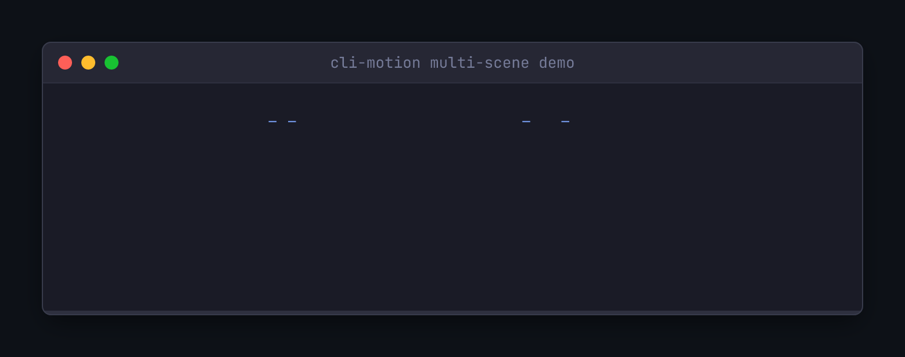

# Examples

Each example is a scene file and its rendered output. Regenerate any of them from the skill folder, for example:

```bash
node scripts/cli-motion.mjs render examples/quick-demo.scene.yaml
node scripts/cli-motion.mjs export examples/quick-demo.scene.yaml --out /tmp/out
```

Output is deterministic: regenerating gives the same bytes.

## quick-demo: one scene, typed command, spinner, highlights

[`quick-demo.scene.yaml`](quick-demo.scene.yaml) · [SVG](quick-demo.svg) · [GIF](quick-demo.gif) · [MP4](quick-demo.mp4)


GIF version:


## framed-demo: gradient banner, powerline prompt, chrome window

[`framed-demo.scene.yaml`](framed-demo.scene.yaml) · [SVG](framed-demo.svg) · [GIF](framed-demo.gif) · [MP4](framed-demo.mp4)


GIF version:


## multi-scene: banner, install, fade to real command output

Three scenes with `clear` and `fade` transitions, a blinking block cursor, a bar spinner and a `run` step that captures real ANSI output.

[`multi-scene.scene.yaml`](multi-scene.scene.yaml) · [SVG](multi-scene.svg) · [GIF](multi-scene.gif) · [MP4](multi-scene.mp4)


GIF version:



## banner-effects: all nine banner effects

`type`, `wipe`, `lines`, `slide`, `rainbow`, `gradient-sweep`, `pulse`, `decrypt`, `glitch`, one scene each (see [banner-effects](../references/banner-effects.md); the colour effects make this a large SVG).

[`banner-effects.scene.yaml`](banner-effects.scene.yaml) · [SVG](banner-effects.svg)



## preview sheet: choosing a look

`cli-motion preview` renders font × size × theme as one labelled PNG ([preview](../references/preview.md)).


## Notes

- `*.cast` files are the generated asciicasts (kept for byte-diffing; `render --cast` writes them).
- MP4 files need ffmpeg to regenerate; GIF has a pure-JS fallback.
