# Banner effects

A banner (`title:` of a scene, or a `banner:` step) can animate. **Default: no effect**, a static banner. Effects are plain JS, need no extra dependency and are **seeded**: the same scene and `seed` give byte-identical output. The last frame of every effect is exactly the static banner, so the loop ends on the same picture a static banner shows.

```yaml
style:
  banner_effect: none            # none | type | wipe | lines | slide | rainbow | gradient-sweep | pulse | decrypt | glitch
  banner_effect_duration: null   # null = the effect's default (table below)
  banner_effect_fps: null        # null = the effect's default
  banner_effect_direction: left  # slide only
  banner_effect_cycles: 1        # colour effects: loops over the duration
scenes:
  - title: { banner: "cli-motion", font: small, effect: rainbow, duration: 2s, fps: 10 }
  - steps:
      - banner: { text: "done", effect: wipe }                       # a banner as a step
      - banner: { block: "◢■◣\n■ok■\n◥■◤", effect: lines, align: left } # any multi-line block
```

Keys on `title:` / `banner:` step: `effect`, `duration` (`1.5s`, `800ms`), `fps` (1-60), `direction`, `cycles`, plus the existing `font`, `gradient`, `style`, `align`, `subtitle`. `banner:` (figlet text) or `block:` (your own lines) is the content. An unknown effect fails with the list of valid ones.

## Effects

Sizes below are the added SVG size for a 10-column-wide `small` banner ("cli-motion", 4 rows) at the default settings; a static banner is 10.4 KB. Bigger banners cost more (more cells per frame).

| Effect | Looks like | Default | Options | Size cost | Use when |
|---|---|---|---|---|---|
| `type` | letters appear one by one, left to right | 1.2s, 20 fps | duration | +7 KB (one frame per letter) | a typed, hacker feel |
| `wipe` | a left → right sweep uncovers the banner | 0.8s, 20 fps | duration, fps | +11 KB | clean, quick intro |
| `lines` | the banner appears row by row | 0.8s, 10 fps | duration | +1 KB (one frame per row) | cheapest reveal; tall banners |
| `slide` | the banner glides in and eases to rest | 0.7s, 20 fps | `direction`: left, right, top, bottom | +11 KB | scene titles |
| `rainbow` | hue travels across the letters | 2.4s, 12 fps | `cycles`, duration, fps | **+130 KB** | a loud hero banner |
| `gradient-sweep` | a gradient travels across the banner; colours from `gradient:` or the theme (`accent`, `accent2`) | 2.4s, 12 fps | `gradient: [a, b, c…]` (2+; hex, theme names), `cycles` | **+112 KB** | on-brand shimmer |
| `pulse` | the banner breathes toward the background colour and back | 1.6s, 12 fps | `cycles` | +17 KB (few distinct frames) | a calm attention cue |
| `decrypt` | random glyphs settle into the text, left to right | 1.4s, 12 fps | duration, fps | +51 KB | "hacking" intros |
| `glitch` | brief row offsets and colour noise, mostly stable | 1.2s, 12 fps | duration, fps | +13 KB | a nervous flicker; cheap |

## Size cost and frame counts

Every frame is a full screen in the SVG. Reveal effects only change a few cells per frame, and identical neighbouring frames are merged, but **colour effects change every cell on every frame**, so they cost the most. Frames = `fps × duration` (rainbow default: 12 × 2.4 = 29 frames). That is why colour effects default to a low 12 fps. `cli-motion render` prints the frames each effect produced and the final SVG size:

```
cli-motion: banner effect rainbow: 29 frames (12 fps × 2.4s) at scenes[4]
cli-motion: banner effects added 151 frames; SVG is 376.2 KB. Lower fps or duration …
```

To shrink: lower `fps` (8 still looks smooth for a slow sweep), shorten `duration`, use `lines`/`pulse`/`glitch`, a smaller `font` (`small`, `mini`), or put one effect banner in a scene and keep the rest static. GitHub renders README images up to several MB, but a hero SVG under ~300 KB loads instantly.

## Rendering rules

Effects redraw the banner in place (cursor up + rewrite), so svg-term produces ordinary terminal frames; the anti-shimmer step then makes them stationary frames toggled by `step-end` visibility, with whole-pixel cell sizes (see [rendering-pitfalls](rendering-pitfalls.md)). Nothing moves as a layer, so text stays crisp. Colours are true-colour, so they survive in the SVG. Effects need the banner to fit the terminal width, like static banners. `bg:` tokens in `banner_style` are ignored by effects.

## Determinism

Effects draw random numbers (decrypt glyphs, glitch bands) from their own LCG seeded with `seed` (default 42), the effect name and the banner text. Same scene, same bytes. Change `seed:` in `style:` for a different but equally repeatable look.

## Capturing an external tool (optional)

`run:` records a command's finished output, not the frames it animated through. For a tool such as [terminaltexteffects](https://github.com/ChrisBuilds/terminaltexteffects) (Python, not required; untested here) that means you can capture its end state, which is rarely what you want from an animation:

```yaml
- run: "echo 'cli-motion' | tte --canvas-width 60 --anchor-text c beams"
  allow_failure: true
  show_command: false
```

For a real animation prefer the native effects above. To use an external tool's frames, record them yourself (`asciinema rec -c "tte …" out.cast`) and render that cast with `npx -y svg-term-cli@2.1.1`.

**Alternatives:** the nine effects in the table above.

**Example:** `examples/banner-effects.scene.yaml` (every effect, one scene each):



## When to use

One effect banner opens a hero animation or a scene; keep colour effects (`rainbow`, `gradient-sweep`) to one banner per clip because of their size, and prefer `type`, `lines` or `glitch` for cheap motion.
