# Banners

**Default:** figlet `standard` font, drawn inside the terminal, coloured with `banner_style` (theme accent).

**Alternatives:** any other figlet font, or cfonts gradients (`block`, `simple3d`, `chrome` …) when `gradient:` is set (exception: with `effect: gradient-sweep`, `gradient:` picks the sweep colours and figlet stays the engine).

**Example:**



```yaml
style:
  banner_font: standard      # any figlet font
  banner_style: accent
  banner_gradient: null      # set to switch every banner to cfonts gradients
scenes:
  - title: { banner: "cli-motion", font: small, subtitle: "terminal animations" }
  - title: { banner: "cli", font: block, gradient: ["#ff6ac1", "#57c7ff"] }
```

A `title:` is a scene's first thing on screen. Keys: `banner` (text), `font`, `subtitle`, `align` (`center`|`left`), `style` (figlet only), `gradient`, `engine`.

| Engine | When | `font` means |
|---|---|---|
| figlet | default | any figlet font: `standard`, `small`, `mini`, `slant`, `big`, … |
| cfonts | `gradient:` given with a static banner (or `engine: cfonts`, or `banner_gradient` set) | `block` (default), `simple`, `simpleBlock`, `simple3d`, `3d`, `chrome`, `huge`, `shade`, `slick`, `grid`, `pallet`, `tiny`, `console` |

A gradient is two or more colours: `#rrggbb`, a theme colour (`accent`, `accent2`, `success`, `warning`, `error`, `info`), an ANSI name, or one preset name (`rainbow`, `pastel`, `vice`, `sunset`, `ocean`, `fire`, `forest`, `mono`). For `effect: gradient-sweep`, `gradient:` selects the sweep colours and figlet is the default engine. cli-motion asks cfonts for true colour itself, so the result does not depend on `NO_COLOR` or `TERM` in your shell, and the SVG keeps every colour.

Banners can animate (type, wipe, rainbow, decrypt, glitch …): see [banner-effects](banner-effects.md). Step form: `- banner: { text: "done" }`; keys `effect`, `duration`, `fps`, `direction`, `cycles`, `block` (multi-line block instead of text).

A banner wider than the terminal fails with advice (shorter text, a smaller font such as `small`/`mini`/`tiny`, or a wider `width`). List figlet fonts: `node -e "console.log(require('figlet').fontsSync().join(' '))"` run inside the dependency cache.

## When to use

A banner opens a hero animation or a scene change. Keep it to one or two words; use `small` for long names. Gradients look best on dark themes; on light themes prefer a plain figlet in `accent`. Do not use banners in short clips: they cost about a second of screen time.

Example: `examples/framed-demo.scene.yaml`.
