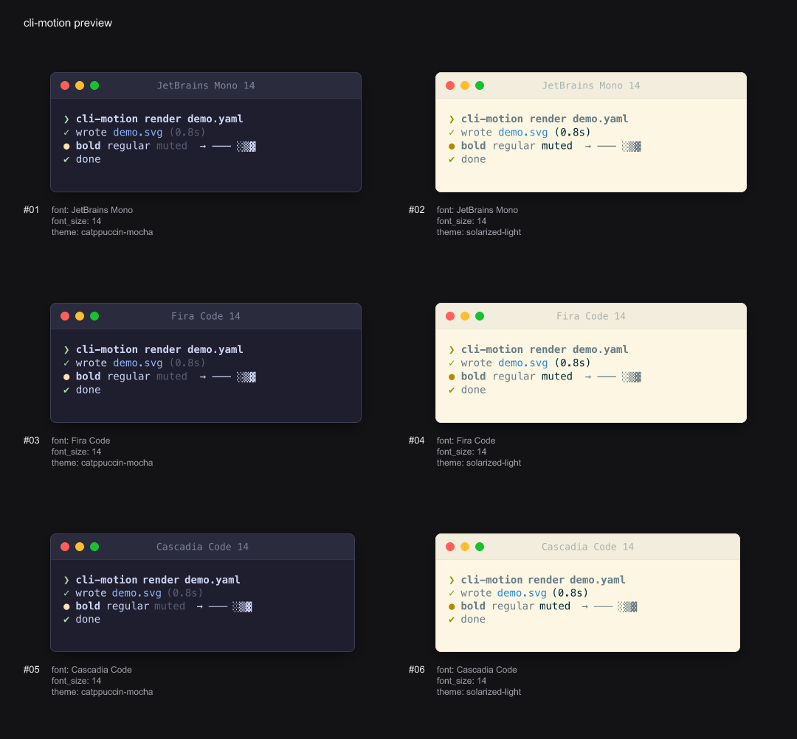

# Fonts

**Default:** JetBrains Mono, 14 px.

**Alternatives:** JetBrains Mono is the default; Fira Code, Cascadia Code, IBM Plex Mono, Source Code Pro, any `font_size`.

**Example:**



```yaml
style:
  font: Fira Code          # JetBrains Mono | Fira Code | Cascadia Code | IBM Plex Mono | Source Code Pro
  font_size: 14            # px, any positive number
  font_nerd: auto          # auto | true | false
```

`node scripts/cli-motion.mjs fonts` lists them, the package each comes from and whether its Nerd Font is cached. To see them side by side use [preview](preview.md).

## How fonts reach the SVG

The fonts come from pinned `@fontsource` packages in the dependency cache. Each render keeps only the glyphs the SVG really uses (regular and bold) and embeds them as woff2 base64 `@font-face`, with a `unicode-range` per face. The SVG is self-contained, so it looks the same on every machine, inside ``, with no network. A typical subset is a few KB.

`@fontsource` fonts have no `❯ ✓ ● →` or braille spinner glyphs. Missing glyphs are taken, glyph by glyph, from DejaVu Sans Mono and Cascadia's braille set (also embedded as subsets). If something is still missing, a note on stderr says so and the viewer's own monospace font draws it.

`font_size` sets the real size: a column is `0.6 × font_size` px wide (Cascadia Code: 0.586), a row 1.3 ×. The image grows with the size; the terminal stays `width` columns.

## Nerd Font

Icons and powerline arrows (U+E000–U+F8FF) are not in the normal fonts. With `font_nerd: auto` (default) the Nerd Font variant of the chosen font is used only when a scene contains such a glyph, for example `prompt: powerline`. `true` forces it, `false` forbids it (powerline then errors).

It is downloaded once into `${XDG_CACHE_HOME:-~/.cache}/cli-motion/fonts/<version>/` from a URL pinned to nerd-fonts `v3.4.0`, and every file is checked against a sha256 pinned in `assets/fonts.json`. A mismatch is refused. Offline with an empty cache the render fails and says so; use a prompt without icons instead.

## When to use

JetBrains Mono for general use. Fira Code or Cascadia Code if the audience knows their ligature look. IBM Plex Mono or Source Code Pro for a calmer, more editorial feel. Sizes 12–13 for dense output on phones' narrow layouts, 16+ for slides.
