# Prompts

**Default:** `simple`, a bold green `❯`.

**Alternatives:** `simple` (`❯`) is the default; `dollar`, `path`, `git`, `template`, `powerline`.

**Example:**



| `prompt:` | Looks like | Notes |
|---|---|---|
| `simple` | `❯ ` | default |
| `dollar` | `$ ` | classic POSIX |
| `path` | `~/app ❯ ` | uses `prompt_cwd` |
| `git` | `~/app on main ❯ ` | `prompt_cwd`, `prompt_branch` |
| `template` | anything | `prompt_template` with `{cwd} {branch} {user} {host} {time} {status}` |
| `powerline` | oh-my-posh style segments: path, git branch, status, joined by arrows | needs the Nerd Font variant; fetched once into the cache, automatically (see [fonts](fonts.md)) |

```yaml
style:
  prompt: template
  prompt_template: "[muted]{user}@{host}[/] [cwd]{cwd}[/] [prompt]❯[/] "
  prompt_user: diego
  prompt_host: mac
  prompt_cwd: "~/dev/app"
```

Templates use the same `[name]…[/]` markup as output, so colours come from the named styles (`prompt`, `cwd`, `branch`, `muted`, or your own). `prompt_time` is a fixed string (default `12:00`) so renders stay byte-identical; `prompt_status` is the text for `{status}`.

A scene can change the prompt for itself: `scenes: - style: { prompt: dollar }`.

## When to use

- `simple` for short clips where the prompt is noise.
- `path`/`git` when context matters (which folder, which branch).
- `template` to match a team's real prompt.
- Multi-line commands get a grey `>` continuation prompt automatically.
