# Scene format

A scene file is YAML: optional `name`, optional `style`, and `scenes` (or a bare `steps` list for a single scene).

```yaml
name: my demo                       # asciicast title (default: cli-motion)
style: { theme: tokyonight-night, prompt: git, speed: 1.2 }
scenes:
  - title: { banner: "cli-motion", font: standard, subtitle: "scene in, animation out" }
    hold: 2s
  - transition: clear
    steps:
      - comment: "# install in a second"
      - command: "npx skills add diegomarino/my-skills@cli-motion"
      - spinner: { text: "installing", for: 1.5s, done: "[ok]✓[/] installed" }
      - output: |
          wrote [accent]demo.svg[/] in [strong]0.8s[/]
      - pause: 2s
  - transition: fade
    steps:
      - run: "printf '%s' 'captured output'"   # executes via sh; real output, ANSI kept
        hold: 4s
```

A bare `steps:` list is one scene. The `npx skills add` text and the `run:` command are examples; replace them with your own.

**`run:` executes real commands** on every render, still and export. The agent must show the user each `run:` command (with `cwd` and `env`) and get permission before rendering; see [SKILL.md](../SKILL.md).

**Default:** one scene, steps in order, every option from `assets/defaults.yaml`. **Alternatives:** several `scenes:` with titles and transitions; per-scene `style:`.

**Example:**



## Steps

Each step has exactly one action; the other keys are options.

| Action | What it does | Options |
|---|---|---|
| `command: "ls"` | prompt, the text typed in bold, Enter. Extra lines get a `>` continuation prompt | |
| `type: "text"` | types at the cursor, no prompt, no Enter | `enter: true`, `prompt: true`, `bold: false`, `style: name` |
| `output: "text"` | a block revealed line by line; `[name]…[/]` markup | `delay` (per line), `instant: true`, `style` |
| `comment: "# note"` | grey line, instant | `typed: true` (typed after a prompt) |
| `pause: 2s` | wait | |
| `spinner: {…}` | animated line that clears itself | `text`, `for`, `preset`, `done`, `style` |
| `run: "cmd"` | **executes a real command** (permission first), shows the typed command and its captured output | `show` (text to display instead), `timeout` (30s), `cwd`, `env`, `show_command: false`, `allow_failure: true`, `delay`, `instant` |
| `banner: {…}` | a banner as a step (keys `text` or `block`, `effect`, `font`, `gradient` …): see [banners](banners.md), [banner-effects](banner-effects.md) | |
| `clear: true` | clears the screen (a bare `- clear` also works) | |
| `prompt: true` | shows a prompt (end a demo on a waiting prompt; a bare `- prompt` also works) | |

Options on every step: `speed` (multiplier for this step), `hold` (pause after the step).

`run` fails the render on a non-zero exit, unless `allow_failure: true` (which keeps the output of a failing command). A timeout or a launch error always fails, raise it with `timeout: 60s`. It runs through `sh -c` in the scene's folder (override with `cwd`) with the shell environment plus `env` and `FORCE_COLOR=1`; stdout and stderr are joined in the output. The result changes when the command, the files it reads or the environment change, so use a stable fixture where output must be repeatable. Commands that move the cursor or redraw the screen will not look right; capture plain output instead.

## Scenes

A scene takes `title` (banner), `steps`, `transition`, `hold` (dwell at the end of the scene; default `scene_hold`, 2s for a title-only scene), and its own `style:` with scene-scoped options only (prompt, cursor, text styles, timing, spinner, banner, transition). Theme, font, window, size, playback and the progress bar are fixed for the whole render.

Durations are `1.5s`, `800ms`, or a bare number of seconds.

## Project settings: `cli-motion.yaml`

A flat map of style options, found in the scene's folder or the nearest parent folder that has one. It sits below the scene's `style:` in precedence (defaults < project file < scene `style:` < per-scene `style:` < step options):

```yaml
# cli-motion.yaml
theme: nord-dark
font: Fira Code
prompt: git
```

Top-level keys of this file are the same names as inside `style:`; do not nest them under `style:`.

## When to use

Start from a bare `steps:` list for one idea; move to `scenes:` when you need a banner, a chapter break or a different prompt/cursor part-way.

## Errors you will see

Unknown keys, steps with two actions, unknown styles and bad durations fail with the scene file name, the YAML path of the problem (for example `scenes[0].steps[2]` or `style`; no line or column) and the valid choices, with a `Did you mean …?` hint for a near-miss key. Nothing is silently ignored.

See also: [themes](themes.md), [prompts](prompts.md), [text-styles](text-styles.md), [timing](timing.md), [transitions](transitions.md).
