# Timing

**Defaults:** typing 45 ms per character plus up to 30 ms of seeded jitter, 120 ms before Enter, 400 ms before a prompt, 50 ms between output lines, 1 s at the end of each scene (2 s for a title-only scene), 3 s final hold on the last scene, speed 1×, seed 42.

**Alternatives:** speed 1× and the delays above are the defaults; `speed`, `typing_delay`, `seed`, per-step `speed`/`hold`.

**Example:**



```yaml
style:
  speed: 1.2          # global: everything 20% faster
  typing_delay: 0.03
  seed: 7
steps:
  - command: "make"
    speed: 3          # this step only: three times faster
  - pause: 2s
  - output: "done"
    hold: 1s          # wait after the step
```

- **Speed** divides every duration (typing, pauses, spinners, holds) except `final_hold`.
- **Determinism:** typing jitter comes from a seeded generator (the same LCG as gh-delta). With the same scene, resolved settings, seed and renderer the cast and SVG are reproducible, so git diffs change only when the scene does. Exceptions: a `run:` step changes the output when its command, the files it reads or the environment change; GIF and MP4 bytes depend on the encoder version and platform (pin them if you compare bytes). Change `seed` to get a different rhythm.
- **Final hold:** `final_hold` is how long the last frame stays before a looping SVG restarts. svg-term derives the loop length from the last event, so the engine appends a no-op event after the hold; without it the hold would silently disappear. See [rendering-pitfalls](rendering-pitfalls.md).
- **`run`** captured output is printed at `line_delay` per line; the real command's duration is not replayed.

## When to use

Keep clips under about 20 seconds. Raise `speed` for long commands, add `pause` before the punchline, and give the last frame a final hold of 3–5 s so people can read it.
