# Window frame

**Default:** `window: chrome`, a title bar with three dots, 8 px rounded corners, a soft shadow, no outer background.

**Alternatives:** `chrome` is the default; `plain`, `none`, shadow off, an outer `window_background`.

**Example:**



```yaml
style:
  window: chrome            # chrome | plain | none
  window_title: "my-cli"    # null = the scene's `name:`
  window_radius: 8          # px
  window_shadow: true
  window_background: null   # "#ffffff": opaque colour around the window (for GIF/MP4; unset = white on light themes, #0d1117 on dark)
  padding: 18               # px between the text and the window edge
```

| `window:` | Result |
|---|---|
| `chrome` | title bar, three dots, optional title, rounded corners, shadow |
| `plain` | no title bar; rounded corners and shadow stay |
| `none` | the bare terminal: no frame, no corners, no shadow |

`window_shadow: false` drops the shadow and the transparent margin it needs. `window_background` fills the whole canvas, margin included, so the corners and shadow sit on a solid colour.

Example: `examples/quick-demo.svg` (chrome) and `examples/framed-demo.svg`.

## When to use

- `chrome` for READMEs and docs: reads as "a terminal" at a glance.
- `plain` when the page already draws its own window.
- `none` to embed in a slide or card that has its own border.
- Set `window_background` whenever the SVG will become a GIF or MP4.

## How the frame is made (and why not `svg-term --window`)

cli-motion runs svg-term with `--padding 0` and no window, then its own post-processor rebuilds the page: root sized to window plus shadow margin; a `<clipPath>` shaped like the rounded window; inside the clipped group the background, title bar, dots, title text, the terminal and the progress bar; a hairline border on top (keeps light themes visible on white pages); under everything an offset black `<rect>` blurred by an SVG `feGaussianBlur` filter.

Reasons for owning it:

- svg-term's `--window` draws fixed dots at fixed positions, no title, a fixed 5 px radius baked into the background `<rect>`, and no shadow. Radius, title, shadow and variants are not options.
- The progress bar and any edge element must be clipped to the same rounded shape. With our `<clipPath>` they are, with the same shape, by construction.
- The terminal is placed with integer `x`/`y` attributes (never a `transform`), so glyph anti-aliasing is identical in every frame and the anti-shimmer work (see [rendering-pitfalls](rendering-pitfalls.md)) is not undone.

Only plain shapes, one filter and one clipPath are used: no scripts, `foreignObject` or external references, so it renders inside `` on GitHub.

## Research: rounded corners, borders and transparency

**What svg-term does.** `--window` adds the three dots and sets `rx="5"` on one background `<rect>`; without it `rx="0"`. Nothing else is configurable: no title, radius, border or shadow. Corner radius is whatever the background rect carries, so anything drawn later (a progress bar) pokes out of the corners unless clipped.

**Our frame.** Radius is a number (`window_radius`) applied to the clipPath, the shadow rect and the border. Everything inside the window is clipped, so nothing can leak past a corner. The border is drawn half a pixel inside the edge so it stays crisp.

**Borders.** A 1 px border mixed 18 % from background towards foreground is always on for `chrome` and `plain`. On a dark theme over a dark page it is nearly invisible; on a light theme over white it is what makes the window read as a window.

**Transparency limits of raster formats.**

- SVG: full alpha. Corners and shadow are transparent; the page shows through.
- PNG: full alpha, fine.
- GIF: 1-bit transparency only. A soft shadow or anti-aliased rounded corners have partial alpha, which a GIF cannot hold; against an unknown page they leave a fringe of the wrong colour. Use `window_background` set to the page colour (or white) so the edge pixels are blended against it before quantising.
- MP4 (H.264, yuv420p): no alpha at all. Transparent areas turn black. Same fix: set `window_background`.

So the rule: SVG and PNG keep transparency; for GIF/MP4 set `window_background` to the colour of the page they will sit on. Without it the exporter picks a neutral opaque colour (white for light themes, `#0d1117` for dark ones). `preview --out sheet.png` writes PNG; `still` writes SVG.
